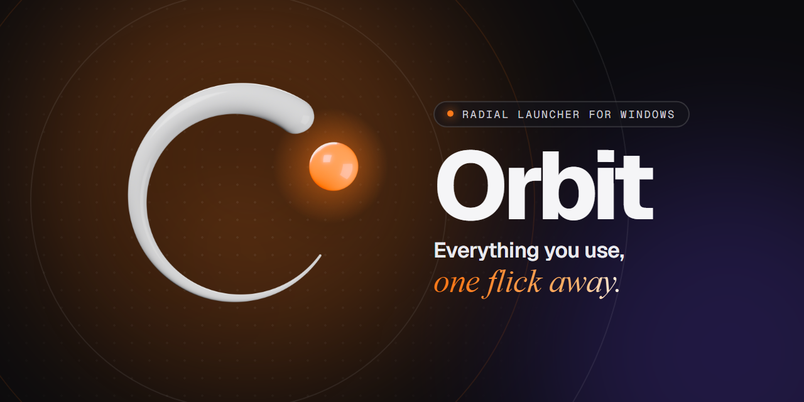
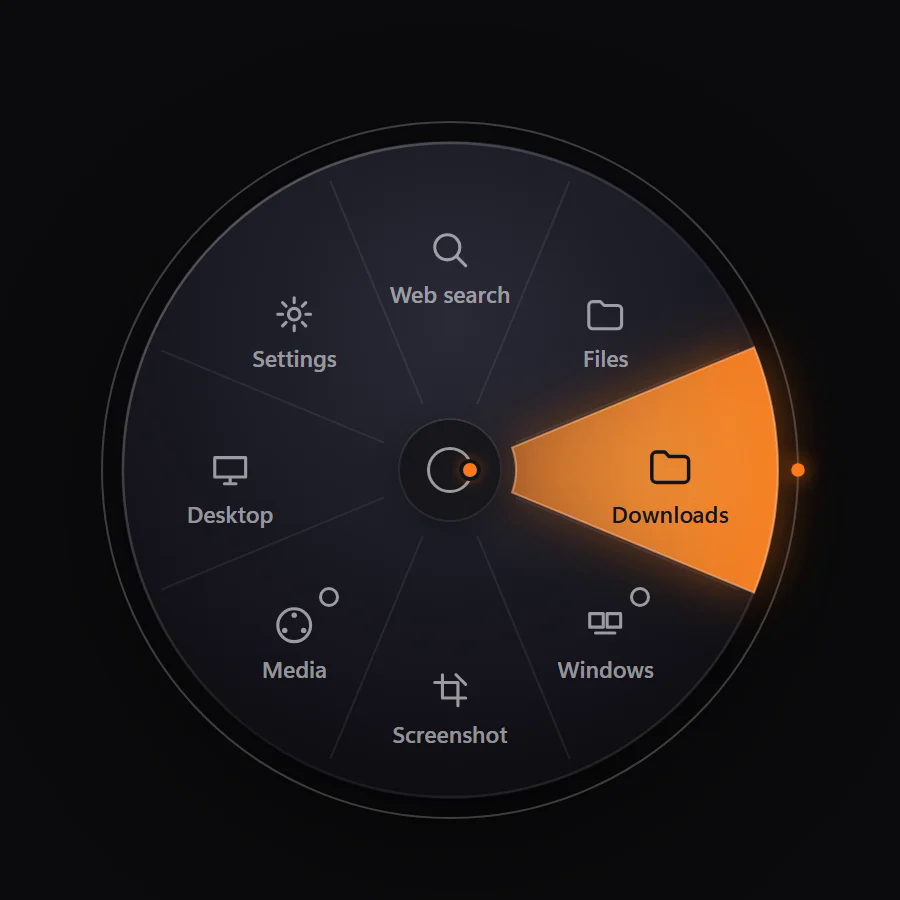
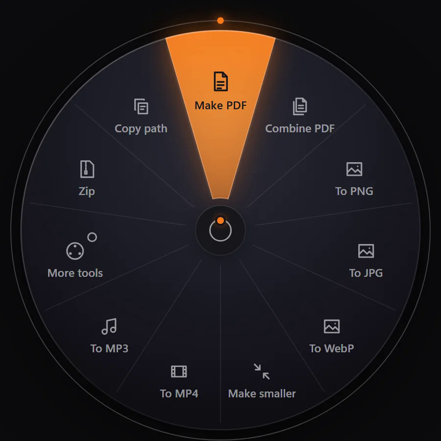
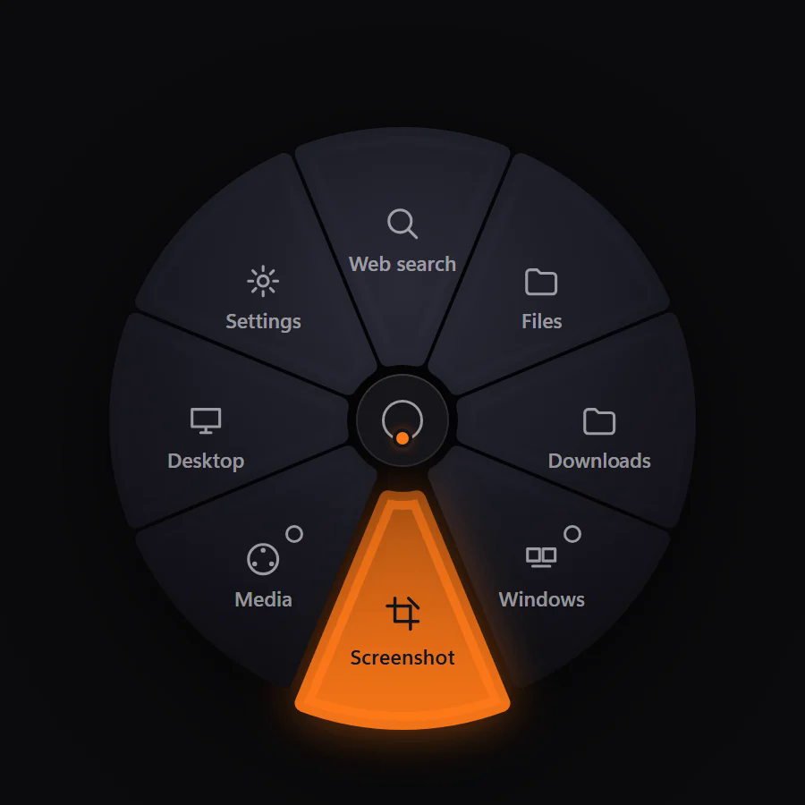
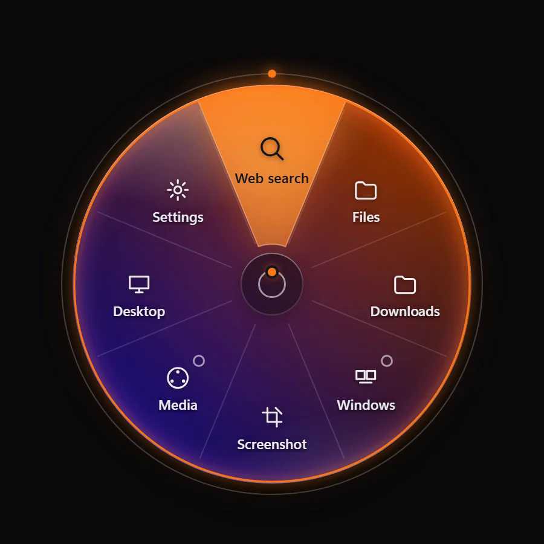

  

<h1 align="center">Orbit</h1>

<b>Everything you use, one flick away.</b> A radial launcher for Windows 10 and 11.

  <a href="https://orbit-official-website.vercel.app">Website</a> ·
  <a href="https://github.com/Avenger11764/Orbit/issues/new/choose">Report a problem</a> ·
  <a href="https://github.com/Avenger11764/Orbit/issues/new?template=feature_request.yml">Suggest an idea</a> ·
  <a href="https://orbit-official-website.vercel.app/guide">Feature guide</a> ·
  <a href="https://orbit-official-website.vercel.app/privacy">Privacy</a>

---

Hold a key or a mouse button and a wheel opens right at your pointer, with your apps, folders, shortcuts, media keys and file conversions. Flick towards one and let go: done.

> **This is Orbit's official public home** for announcements, releases, bug reports, ideas and questions. Orbit's source code is not published here.

## What Orbit does

<table>
  <tr>
    <td width="50%"></td>
    <td width="50%"></td>
  </tr>
  <tr>
    <td><b>Opens where you are.</b> Hold <kbd>Ctrl</kbd> <kbd>Space</kbd>, or the right, middle or side mouse button. The wheel appears around your pointer, on any screen.</td>
    <td><b>Convert files in a flick.</b> Point at a file in File Explorer: pictures to PDF, PNG, JPG or WebP, video to MP4, audio to MP3, Word, Excel and PowerPoint to PDF, many files at once.</td>
  </tr>
  <tr>
    <td></td>
    <td></td>
  </tr>
  <tr>
    <td><b>Rings inside rings, and a wheel for every app.</b> Group media keys or window snapping into one slice; Orbit switches to the right wheel for the app in front.</td>
    <td><b>Make it yours.</b> One wheel, slices or tiles; dark, light or high contrast; liquid glass; any accent colour.</td>
  </tr>
</table>

- **Gallery:** ready-made wheels for 28 popular apps and 25 ready-made rings.
- **Polite with games:** stays out of fullscreen apps and the apps you choose.
- **Private by design:** no account, no tracking; files are converted on your PC and never uploaded.

## Get Orbit

Orbit is coming to the **Microsoft Store**. Store apps are signed by Microsoft, install without warnings and update automatically. Follow this repository (**Watch › Custom › Releases**) to hear when it's out.

### Free and Pro

| | Orbit Free | Orbit Pro |
|---|---|---|
| Slices per wheel | 7 | 12 |
| Rings inside rings | 1 level | 3 levels |
| App wheels | 1, plus the Files wheel | Unlimited, each with its own shortcut |
| Apps, files, folders, websites, shortcuts, media keys, window snapping | ✓ | ✓ |
| File tools: zip, copy path, terminal here | ✓ | ✓ |
| Convert files: pictures, PDFs, video, audio, Office | | ✓ |
| Text tools, snippets, macros, clipboard history | | ✓ |
| Looks | One wheel; dark, light, high contrast; any accent colour | Slices, Tiles, liquid glass, every theme and animation |

Orbit Pro is a one-time purchase in the Microsoft Store, and you can try it free for a day.

### System requirements

- Windows 10 or Windows 11, 64-bit (x64)
- Office to PDF needs Word, Excel or PowerPoint installed
- HEVC videos need Microsoft's HEVC Video Extensions

## Help and support

1. **Quick answers:** the [troubleshooting guide](https://orbit-official-website.vercel.app/troubleshooting) and the [feature guide](https://orbit-official-website.vercel.app/guide).
2. **From inside Orbit:** open Settings › **Help & feedback** (bottom of the sidebar). It can attach a privacy-safe log and shows you exactly what will be sent first. Reports sent this way reach the developer privately.
3. **Here on GitHub:** [open an issue](https://github.com/Avenger11764/Orbit/issues/new/choose) to report a bug, suggest an idea or ask a question. Issues here are public, so please don't include personal information.

Please search [existing issues](https://github.com/Avenger11764/Orbit/issues) first; if yours is there, add a 👍 instead of a new issue.

See [SUPPORT.md](SUPPORT.md) for details, and [SECURITY.md](SECURITY.md) to report a security problem privately.

## Privacy

Orbit runs on your PC. It has no account, no ads and no analytics, and it sends nothing unless you choose to send a report. Read the [privacy policy](https://orbit-official-website.vercel.app/privacy).

---

© 2026 Orbit. Windows is a trademark of Microsoft; Orbit is not affiliated with Microsoft.

